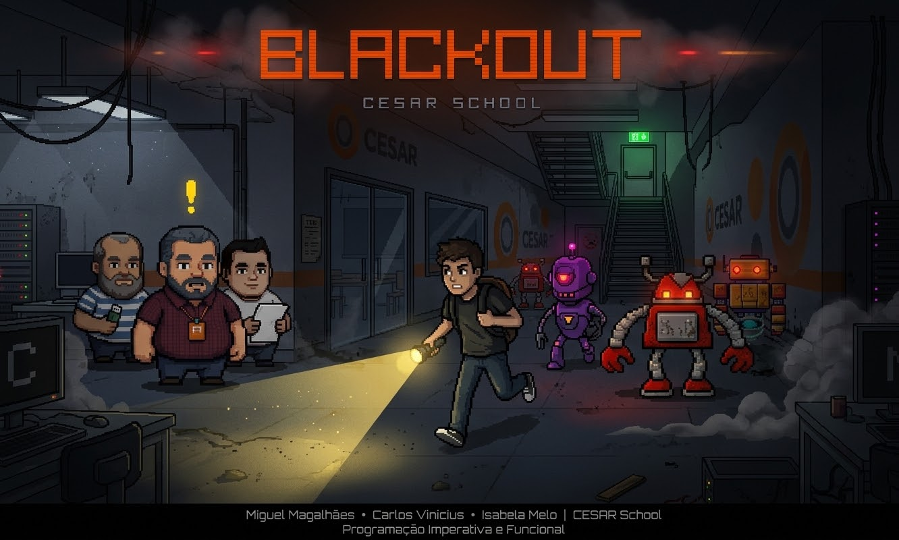

## A História

A CESAR School foi invadida por hackers e a energia do prédio está falhando. Você é um aluno do 8º período e seus arquivos do TCC sumiram dos servidores. Por sorte, os professores de PIF estavam com cópias do seu projeto para análise de feedbacks.

Para recuperá-los, você precisa atravessar os três andares do prédio, encontrar o professor de cada andar, responder à pergunta dele e fugir pela escada de incêndio. Mas cuidado: os hackers invadiram o sistema do Tiradentes e corromperam os robôs do professor Mineiro, que agora têm o objetivo de capturar você e destruir os seus arquivos.

---

## Como Jogar

Link Video: https://youtu.be/o0_WP-i9B98

Cada andar é um labirinto de corredores e salas. O objetivo principal em todos eles é o mesmo:

1. **Encontre o professor** do andar (marcado com um `!` amarelo) e interaja com ele.
2. **Responda ao quiz** de múltipla escolha. Se errar, você pode tentar novamente. Ao acertar, você recebe o pendrive e sua bateria é recarregada.
3. **Vá até a escada** do andar (que muda de cinza para verde após o quiz) para subir ao próximo nível.

Ao concluir o terceiro andar, a tela de vitória é exibida com o tempo total da partida.

### Progressão e Desafios por Andar

A cada andar, os robôs evoluem e adicionam novas mecânicas ao jogo:

* **1º Andar (Agressividade):** Os robôs são hostis e atacam caso você não use a lanterna. O robô roxo tenta alcançar o professor primeiro para destruir o pendrive.
* **2º Andar (Sabotagem):** Percebendo a vulnerabilidade à luz, o robô cinza passa a buscar e destruir todas as baterias espalhadas pelo mapa. Você precisa ser mais rápido do que ele.
* **3º Andar (Curto-Circuito):** Agora robô cinza emite uma interferência que causa um curto-circuito neural no jogador, invertendo ou alterando seus controles de movimento.

---

## Mecânicas e Recursos

### Baterias e Lanterna
Existem baterias espalhadas por cada andar, mas você só consegue coletar uma nova quando a carga atual estiver completamente zerada. Cada bateria restaura 100% da carga.

* **Ativação:** Pressione `L` para acender a lanterna (duração máxima de **10 segundos**).
* **Efeito:** Enquanto a lanterna está acesa, todos os robôs (exceto o roxo) ficam azulados, reduzem a velocidade e fogem ao se aproximarem do feixe de luz.

### Vidas e Game Over
Você inicia a partida com **3 corações**. Encostar em qualquer robô com a lanterna desligada custa 1 coração. O **Game Over** ocorre em duas situações:

* Se todos os seus corações acabarem.
* Se o robô roxo alcançar o professor antes de você concluir o quiz.

Na tela de Game Over, pressione `R` para reiniciar a partida a partir do 1º andar.

### Interface e Visões
* **HUD Inferior:** Exibe corações, andar atual, carga da bateria, status do pendrive, lanterna, cronômetro e objetivo.
* **Alerta de Proximidade:** Quando um robô entra em um raio de 8 casas, um alerta pisca no topo da tela mudando de cor conforme a distância (amarelo → laranja → vermelho).
* **Modos de Câmera:** É possível alternar em tempo real entre a visão superior (**2D**) e a visão em primeira pessoa (**3D** com minimapa no canto).

---

## Tipos de Robôs

Todos os robôs calculam o menor caminho pelo labirinto até o seu alvo e ficam mais rápidos a cada andar:

| Robô | Papel | Comportamento |
| :--- | :--- | :--- |
| **Vermelho** | Perseguidor | Vai diretamente atrás da sua posição atual. |
| **Laranja** | Interceptador | Antecipa sua trajetória e planeja rotas para emboscar você. |
| **Roxo** | Temporizador | Ignora o jogador e vai direto até o professor. Se chegar antes de você responder ao quiz, causa Game Over. Após o quiz, passa a perseguir você. |
| **Cinza** | Especial | A cada fase recebe um Update de habilidades, cada vez mais forte. |
---

## Controles

| Contexto | Tecla | Ação |
| :--- | :--- | :--- |
| **Tela inicial** | `Enter` ou `Espaço` | Começar o jogo |
| **Visão 2D** | `W` `A` `S` `D` ou Setas | Mover o personagem (segurar mantém o movimento) |
| **Visão 3D** | `W` ou Seta para cima | Andar para frente |
| **Visão 3D** | `S` ou Seta para baixo | Andar para trás |
| **Visão 3D** | `A` / `D` ou Setas laterais | Girar 90° para a esquerda / direita |
| **Durante o jogo** | `V` | Alternar entre visão 2D e 3D |
| **Durante o jogo** | `L` | Ativar lanterna |
| **Durante o jogo** | `P` | Pausar e retomar o jogo |
| **Quiz** | `A` `B` `C` `D` | Selecionar alternativa |
| **Game Over** | `R` | Reiniciar do 1º andar |
| **Geral** | `F11` | Alternar tela cheia |
| **Geral** | `Esc` | Fechar o jogo |

---

## Instalação e Execução

O projeto foi desenvolvido em **C99** utilizando a biblioteca gráfica [raylib](https://www.raylib.com/).

### Pré-requisitos no Windows

1. Baixe o **w64devkit** (versão x64) e extraia em `C:\w64devkit`.
2. Adicione `C:\w64devkit\bin` à variável de ambiente `Path` do Windows (caso exista outra instalação do MinGW, garanta que o `w64devkit` fique acima dela na lista).
3. Baixe o pacote `raylib-*_win64_mingw-w64.zip` na página de releases do GitHub da raylib e extraia de forma que existam os diretórios `C:\raylib\include` e `C:\raylib\lib`.
4. Abra um novo terminal e valide a instalação com `gcc --version` e `make --version`.

> **Nota:** Caso a raylib esteja em outro diretório, informe o caminho na compilação: `make RAYLIB_PATH=D:/minhapasta/raylib`.

### Pré-requisitos no macOS

Instale as ferramentas de linha de comando e a biblioteca via [Homebrew](https://brew.sh/):

    xcode-select --install
    brew install raylib

### Comandos de Compilação

Execute os comandos a partir da **raiz do projeto** (necessário para que o executável localize as pastas `imagens/` e `andares/`):

| Comando | Descrição |
| :--- | :--- |
| `make` | Compila o projeto e gera os arquivos em `build/` |
| `make run` | Compila e inicia o jogo automaticamente |
| `make clean` | Remove a pasta `build/` e os arquivos compilados |

Ao encerrar o jogo, o terminal exibirá `Blocos nao liberados: N` (gerado pelo módulo `memoria.c`). O valor esperado sem vazamentos de memória é `0`.

---

## Arquitetura do Projeto

### Estrutura de Diretórios

| Diretório | Conteúdo |
| :--- | :--- |
| `src/` | Arquivos de código-fonte (`.c`) |
| `include/` | Arquivos de cabeçalho (`.h`), incluindo as structs globais em `estrutura.h` |
| `andares/` | Mapas em texto puro (`andar1.txt`, `andar2.txt` e `andar3.txt`) |
| `imagens/` | Sprites do jogador, dos professores, dos robôs e itens |
| `build/` | Arquivos objeto e executável gerados pelo `make` |

### Módulos em `src/`

| Arquivo | Responsabilidade |
| :--- | :--- |
| `main.c` | Inicialização da janela, game loop, leitura de inputs, transição de andares e limpeza |
| `mapa.c` | Leitura dos arquivos de fase, alocação da matriz e renderização 2D |
| `render3d.c` | Renderização da visão 3D em primeira pessoa e do minimapa |
| `hud.c` | Barra de status, alertas de proximidade e telas de pausa, vitória e game over |
| `telainicial.c` | Tela de abertura e contextualização da história |
| `jogador.c` | Movimentação, rotação na câmera 3D e renderização do jogador |
| `itens.c` | Gerenciamento da lista encadeada de baterias (criação, coleta, desenho e liberação) |
| `professor.c` | Posicionamento dos professores, banco de perguntas e lógica do quiz |
| `robos.c` | Inteligência artificial dos robôs (BFS, fuga, colisões) e gerenciamento da lista |
| `jogo.c` | Carregamento e descarregamento de texturas |
| `memoria.c` | Wrappers `memAlocar` e `memLiberar` com rastreamento de blocos alocados |

### Formato dos Mapas (`andares/*.txt`)

A primeira linha define as dimensões da matriz (`linhas colunas`, padrão `25 40`). As linhas seguintes desenham o layout utilizando os caracteres abaixo:

| Caractere | Elemento | Observação |
| :--- | :--- | :--- |
| `#` | Parede | Bloqueia passagem e visão |
| `.` | Piso de corredor | Andável |
| ` ` (espaço) | Piso de sala | Andável |
| `=` | Tapete CESAR | Andável (blocos retangulares contínuos formam um único tapete) |
| `M` | Mesa | Obstáculo sólido |
| `C` | Computador | Obstáculo sólido |
| `P` | Spawn do jogador | Deve coincidir com a posição `S` do andar anterior |
| `S` | Escada de saída | Libera o próximo andar após o quiz |
| `I` | Bateria | Item coletável |
| `F` | Professor | Obrigatório (o mapa não carrega sem um `F`) |
| `R` | Robô Roxo | Temporizador |
| `X` | Robô Vermelho | Perseguidor |
| `Z` | Robô Laranja | Interceptador |
| `B` | Robo Cinza | Especial

> Caracteres de entidades (`P`, `S`, `I`, `F`, `R`, `X`, `Z`, `B`) são convertidos em piso durante o carregamento, herdando o tipo de piso da célula imediatamente à esquerda.

---

## Conceitos Aplicados

Mapeamento dos fundamentos da disciplina de **Programação Imperativa e Funcional** utilizados no projeto:

| Conceito | Implementação no Código |
| :--- | :--- |
| **Structs** | Definidas em `include/estrutura.h` (`Posicao`, `Mapa`, `Jogador`, `Item`, `Professor`, `Robo` e `Jogo`, que centraliza o estado global). |
| **Ponteiros** | Passagem de `Jogo *` por referência entre módulos; uso de ponteiros duplos (`Item **`, `Robo **`) para manipulação do início das listas encadeadas e `char **` para a matriz do mapa. |
| **Alocação Dinâmica** | Encapsulamento de `malloc` e `free` via `memAlocar` e `memLiberar` (`memoria.c`), com relatório de vazamentos (`memRelatorio`) ao fechar o programa. |
| **Listas Encadeadas** | Listas simplesmente encadeadas para gerenciar dinamicamente as baterias (`Item` em `itens.c`) e os inimigos (`Robo` em `robos.c`). |
| **Matrizes** | Representação do mapa (`char **`) e matrizes auxiliares `visitado` e `pai` utilizadas no algoritmo de busca em largura (`calcularProximoPassoBFS` em `robos.c`). |
| **Manipulação de Arquivos** | Leitura dinâmica dos mapas com `fopen`, `fscanf`, `fgets` e `fclose` em `mapa.c`, utilizando `snprintf` para montar os caminhos dos arquivos e estruturação/preenchimento de Ranking. |

---

## Equipe

* **Miguel Magalhães Drechsler**
* **Carlos Vinicius Nascimento**
* **Isabela Melo da Silva**

*Disciplina de Programação Imperativa e Funcional — CESAR School, 2026.2.*
